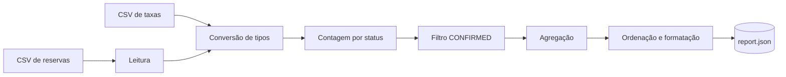

<div align="center">

# 🏨 Onfly — Consolidador de reservas de hotel

### Relatório de entrega


**Candidato(a):** _Leonardo Romano Andrade_ · **Data:** _2026-11-13_  

</div>

---

## 📋 Sumário

- [Resumo](#-resumo)
- [Defeitos corrigidos](#-defeitos-corrigidos)
- [Detalhe de cada correção](#-detalhe-de-cada-correção)
- [Como investiguei](#-como-investiguei)
- [Decisões de interpretação](#-decisões-de-interpretação)
- [Como validar](#-como-validar)
- [Resultado do pytest](#-resultado-do-pytest)
- [Testes adicionais](#-testes-adicionais)
- [Limitações conhecidas](#-limitações-conhecidas)
- [Uso de IA](#-uso-de-ia)

---

## 🎯 Resumo

> [!NOTE]
> _Duas ou três frases: o que o CLI fazia de errado, quantos defeitos foram encontrados e qual é
> o estado final._

| | Antes | Depois |
|-|:-:|:-:|
| Testes fornecidos (`pytest tests`) | _ / 5 | _ / 5 |
| `total_reservations` (base real) | _ | _ |
| `total_room_nights` (base real) | _ | _ |
| `total_amount_brl` (base real) | _ | _ |
| Divergências contra o gabarito | _ | _ |

---

## 🐞 Defeitos corrigidos

| # | Defeito | Arquivo | Causa raiz (uma frase) | Teste que cobre |
|:-:|-|-|-|-|
| 1 | _ | `_` | _ | `_` |
| 2 | _ | `_` | _ | `_` |
| 3 | _ | `_` | _ | `_` |
| 4 | _ | `_` | _ | `_` |
| 5 | _ | `_` | _ | `_` |

> [!IMPORTANT]
> _Destaque aqui o defeito que os testes fornecidos não detectavam, se houver._

---

## 🔧 Detalhe de cada correção

<details>
<summary><b>1 · _título do defeito_</b></summary>

<br>

**Sintoma:** _o que aparecia no relatório_

**Causa raiz:** _por que acontecia_

```diff
- linha antiga
+ linha nova
```

**Regra do README:** _citação da regra violada_

**Validação:** _teste ou comparação que comprova a correção_

</details>

<details>
<summary><b>2 · _título do defeito_</b></summary>

<br>

**Sintoma:** _

**Causa raiz:** _

```diff
- linha antiga
+ linha nova
```

**Regra do README:** _

**Validação:** _

</details>

<details>
<summary><b>3 · _título do defeito_</b></summary>

<br>

**Sintoma:** _

**Causa raiz:** _

```diff
- linha antiga
+ linha nova
```

**Regra do README:** _

**Validação:** _

</details>

<details>
<summary><b>4 · _título do defeito_</b></summary>

<br>

**Sintoma:** _

**Causa raiz:** _

```diff
- linha antiga
+ linha nova
```

**Regra do README:** _

**Validação:** _

</details>

<details>
<summary><b>5 · _título do defeito_</b></summary>

<br>

**Sintoma:** _

**Causa raiz:** _

```diff
- linha antiga
+ linha nova
```

**Regra do README:** _

**Validação:** _

</details>

---

## 🔍 Como investiguei

### Pipeline do CLI



### Abordagem

1. _Passo 1_
2. _Passo 2_
3. _Passo 3_

### Evolução das divergências

| Etapa | Correção | Divergências | Testes fornecidos |
|:-:|-|:-:|:-:|
| 0 | Código original | _ | _ / 5 |
| 1 | _ | _ | _ / 5 |
| 2 | _ | _ | _ / 5 |
| 3 | _ | _ | _ / 5 |
| 4 | _ | _ | _ / 5 |
| 5 | _ | _ | _ / 5 |

---

## ⚖️ Decisões de interpretação

| Tema | Decisão | Justificativa |
|-|-|-|
| _ | _ | _ |
| _ | _ | _ |

---

## ✅ Como validar

```bash
python3.11 -m venv .venv
source .venv/bin/activate
pip install -r requirements-dev.txt

# relatório da base real
PYTHONPATH=src python -m onfly_report \
  --input data/reservas_hoteis.csv \
  --rates data/taxas_cambio.csv \
  --output output/report.json

# amostra de validação do README
PYTHONPATH=src python -m onfly_report \
  --input data/exemplo-validacao.csv \
  --rates data/taxas_cambio.csv \
  --output output/exemplo.json

# testes
pytest -q
```

**Saída esperada no stdout (base real):**

```text
_
```

---

## 🧪 Resultado do pytest

```text
_ cole aqui a saída de `pytest -q` _
```

| Grupo | Passam | Falham | xfail |
|-|:-:|:-:|:-:|
| Testes fornecidos | _ | _ | — |
| Testes adicionais | _ | _ | _ |
| **Total** | **_** | **_** | **_** |

---

## ➕ Testes adicionais

| Arquivo | O que cobre | Testes |
|-|-|:-:|
| `tests/_` | _ | _ |
| `tests/_` | _ | _ |
| `tests/_` | _ | _ |

> [!TIP]
> _Explique aqui o significado dos testes marcados com `xfail`, se houver._

---

## 🚧 Limitações conhecidas

> [!WARNING]
> _Comportamentos com entradas fora do contrato que não foram tratados, e por quê._

- [ ] _
- [ ] _
- [ ] _

---

## 🤖 Uso de IA

| | |
|-|-|
| **Ferramenta** | _ |
| **Modelo(s)** | _ |
| **Sessão exportada** | [`uso-de-ia/`](uso-de-ia/) |
| **Declaração** | [`uso-de-ia/declaracao.md`](uso-de-ia/declaracao.md) |

<details>
<summary><b>O que a IA fez · o que eu fiz</b></summary>

<br>

| IA | Eu |
|-|-|
| _ | _ |
| _ | _ |

</details>

---

## 📦 Checklist da entrega

- [ ] O CLI roda com Python 3.11 (`PYTHONPATH=src python -m onfly_report ...`)
- [ ] O comando de execução gera `output/report.json` sem erro
- [ ] O relatório segue o contrato do README
- [ ] `pytest -q` passa com os testes fornecidos, sem alteração
- [ ] `entrega/README-ENTREGA.md` preenchido
- [ ] Sessão e declaração em `entrega/uso-de-ia/`
- [ ] Repositório público no GitHub e link enviado

<div align="center">
<sub>Feito para o processo seletivo da Onfly</sub>
</div>
